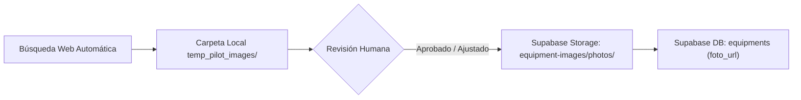

# Diseño Técnico: Prueba Piloto de Descarga y Asociación de Fotos de Equipos

**Fecha:** 2026-11-12  
**Estado:** Aprobado para diseño  
**Autor:** Antigravity (Senior Architect)  
**Proyecto:** biomed-maintenance-app  

---

## 1. Contexto y Objetivos

Actualmente el inventario del HUSJ cuenta con **3.359 equipos biomédicos**, de los cuales **2.861 no tienen foto asociada** (`foto_url` nulo o vacío). Sin embargo, al analizar la distribución por marca y modelo, estos 2.861 equipos corresponden a solo **595 modelos únicos**.

El objetivo de esta prueba piloto es implementar y validar un flujo automatizado y supervisado de adquisición y vinculación de imágenes para los **10 modelos más frecuentes** del inventario, impactando directamente a **524 equipos** en la base de datos de Supabase y en las Hojas de Vida v5.0.

---

## 2. Alcance del Piloto

### Los 10 Modelos Seleccionados (524 Equipos)

| # | Tipo de Tecnología | Marca | Modelo | Cantidad Equipos | Nombre Archivo Sugerido |
|---|---|---|---|:---:|---|
| 1 | FLUJÓMETRO / FLUJÓMETRO DOBLE | Gentec | FM-197B-15L-CH | 85 | `Gentec_FM-197B-15L-CH.png` |
| 2 | TENSIÓMETRO DIGITAL | Lenz | GZ-805 | 61 | `Lenz_GZ-805.png` |
| 3 | PULSOXÍMETRO DIGITAL | Oxywatch | MD300C29 | 60 | `Oxywatch_MD300C29.png` |
| 4 | GLUCÓMETRO | Caresens | N VOICE | 59 | `Caresens_N_VOICE.png` |
| 5 | FLUJÓMETRO / FLUJÓMETRO DOBLE | Pahsco | 434 | 48 | `Pahsco_434.png` |
| 6 | TERMOHIGRÓMETRO | Htc | HTC-2 | 48 | `Htc_HTC-2.png` |
| 7 | VACUTRON / REGULADOR VACÍO | Acare | VRA-391 | 43 | `Acare_VRA-391.png` |
| 8 | FLUJÓMETRO | Acare | FA-OS-04 | 42 | `Acare_FA-OS-04.png` |
| 9 | ASPIRADOR DE SECRECIONES | Pulmo-Med | 7E-A | 39 | `Pulmo-Med_7E-A.png` |
| 10 | MONITOR DE SIGNOS VITALES | Edan | iM70 | 39 | `Edan_iM70.png` |

---

## 3. Arquitectura y Componentes

El proceso se divide estrictamente en dos fases para garantizar la fidelidad clínica y permitir la supervisión humana antes de persistir en producción:



### Componente 1: `scripts/download_pilot_images.cjs`
* **Entrada:** Catálogo de los 10 modelos piloto.
* **Mecanismo de búsqueda:**
  - Consulta web con términos específicos: `"${tipo} ${marca} ${modelo} equipo medico"`.
  - Extracción y validación de URLs de imágenes candidatas (Content-Type: `image/jpeg`, `image/png`, `image/webp`).
  - Descarga en la carpeta local `biomed-maintenance-app/temp_pilot_images/`.
* **Salida:** 10 archivos de imagen nombrados con el patrón `${marca}_${modelo}.png`.

### Componente 2: Puerta de Control y Calidad (Human-in-the-Loop)
* El usuario abre `biomed-maintenance-app/temp_pilot_images/` en el explorador de archivos.
* Verifica visualmente las 10 imágenes. Si alguna imagen presenta fondo no deseado o no corresponde al equipo, se puede reemplazar manualmente conservando el mismo nombre de archivo.

### Componente 3: `scripts/upload_pilot_images.cjs`
* **Entrada:** Archivos validados en `temp_pilot_images/`.
* **Subida a Storage:**
  - Bucket: `equipment-images`
  - Ruta de destino: `photos/${filename}`
  - Opciones: `upsert: true`
* **Actualización en Base de Datos:**
  - Consulta los registros coincidentes en `equipments`:
    ```sql
    UPDATE equipments
    SET foto_url = :publicUrl
    WHERE UPPER(TRIM(marca)) = UPPER(TRIM(:marca))
      AND UPPER(TRIM(modelo)) = UPPER(TRIM(:modelo))
      AND (foto_url IS NULL OR foto_url = '');
    ```
  - **Protección de datos:** Bajo ninguna circunstancia sobreescribe fotos personalizadas preexistentes.

---

## 4. Criterios de Aceptación y Pruebas

1. **Descarga:** Los 10 modelos deben tener su archivo correspondiente en `temp_pilot_images/`.
2. **Almacenamiento:** Las imágenes deben subirse al bucket `equipment-images/photos/` con acceso público verificado vía URL HTTP 200.
3. **Persistencia:** Al menos 500 equipos deben ver actualizado su campo `foto_url` en Supabase.
4. **Visualización UI y PDF:**
   - La foto debe mostrarse correctamente en la tarjeta/detalle del equipo en `Inventory.tsx`.
   - La foto debe incrustarse correctamente en el cuadrante de foto de la Hoja de Vida GRF3MAN-FR18 v5.0 en PDF.

---

## 5. Extensibilidad Futura

Una vez aprobado este piloto, el mismo pipeline podrá procesar en lotes de 20-50 modelos las 585 combinaciones restantes, permitiendo automatizar el 100% de la fototeca institucional de forma ordenada y sin sobrecargar la red ni la base de datos.

